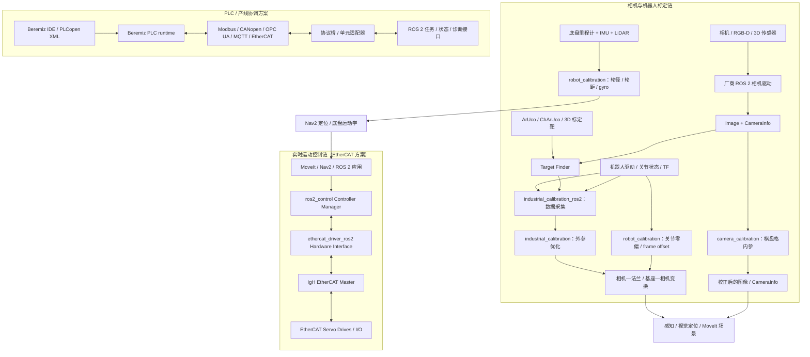

# 机器人开源项目与工具链索引

> 本页是机器人开源生态的选读地图，不是“最佳项目排行榜”，也不代表仓库中列出的项目已在本项目目标硬件上运行。快照日期：**2026-11-05**。版本、发行版支持、许可证和维护状态会变化；工程落地必须锁定 tag/commit、依赖、构建环境和测试报告。

本索引优先纳入有明确上游仓库/官方文档、能定位到具体软件职责且对机器人系统有代表性的项目。更细的算法原理、安装过程和内部项目验证见 [[ROS与ROS2]]、[[Nav2导航框架]]、[[仿真平台]]、[[SLAM总览]]、[[路径规划算法]]、[[轨迹优化与运动控制]]、[[多机协同与调度算法]]、[[学习型机器人算法]]。

## 1. 如何阅读项目状态

### 1.1 证据等级

| 本页用语 | 依据 | 不代表什么 |
|---|---|---|
| 官方维护/近期发布 | 上游发行说明、受维护的 ROS Index 条目或近期正式 release | 不代表每个平台、分支和第三方插件都持续可用 |
| LTS | 上游明确给出长期支持期限 | 不代表完整依赖树、硬件 BSP、驱动和厂商 SDK 同期限维护 |
| 上游不再积极维护 | 上游 README/维护公告明确声明 | 不代表所有社区 fork、ROS 二进制包都停止发布 |
| 版本快照 | 截至快照日可查的 release/tag、ROS Index 或 changelog | 不等同本项目安装版本，也不保证是生产部署的推荐版本 |
| 需单独审查 | 许可证、模型/数据/资产或依赖有独立条件 | 不可只凭根目录 LICENSE 作全栈合规结论 |

GitHub 最近提交时间、Star 数、Issue 数、下载数只能作为调查线索，不能代替软件质量、功能安全、实时性、可维护性和现场可靠性评估。

### 1.2 许可证阅读纪律

1. **仓库许可证不等于整个产品栈许可证。** ROS 2、Nav2、MoveIt、Isaac ROS 等含多个 package/repository，需逐项检查 package.xml、LICENSE、NOTICE、第三方依赖和二进制分发条款。
2. **代码、模型权重、训练数据、数据集、仿真资产、CAD 模型和固件可能使用不同许可证。** 例如 Isaac GR00T 代码与权重不是同一许可；LeRobot 的数据集、模型和外部机器人适配包也需分别核对。
3. **开源不等于无条件商用。** 还要检查专利授权、署名/NOTICE、修改文件标识、源代码提供义务、模型使用限制、商标、云服务和再分发条款。
4. 下面的许可证栏仅标出已核实的上游仓库/核心组件口径；出现“多许可证”“逐包核对”或“需法律审查”时，不可用单一 SPDX 标签替代完整合规清单。

## 2. 机器人基础软件与控制框架

| 项目 | 上游与职责 | 许可证（上游口径） | 版本/维护快照（2026-11-04） | 适用边界与风险 |
|---|---|---|---|---|
| ROS 2 | [ros2/ros2](https://github.com/ros2/ros2)；机器人通信、节点、组件、消息/服务/Action、构建和运行生态 | ROS 2 由多个仓库和 package 构成，没有可覆盖所有组件的单一许可证；按 package/repository 核对 | Lyrical Luth 于 2026-05 发布，为 LTS，支持至 2031-05；官方平台表列 Ubuntu 26.04 amd64/arm64 为 Tier 1，Ubuntu 24.04 对 Lyrical 为 Tier 3 | LTS 只描述发行版支持窗口；目标 CPU、OS/内核、RMW、BSP、驱动、第三方包和编译器仍需逐项锁定。Rolling 是开发分支，不应直接等同稳定产品基线。来源 #160–#161、#541 |
| Navigation2（Nav2） | [ros-navigation/navigation2](https://github.com/ros-navigation/navigation2)；ROS 2 移动机器人导航框架，含行为树、全局规划、局部控制、Costmap 和可选扩展 | 混合许可证：Apache-2.0、BSD-3-Clause、LGPL-2.1-or-later 等；逐 package.xml 核验 | 上游 latest release 为 1.5.3（2026-10-17）；GitHub release 说明包含 Lyrical 同步 | Nav2 不是完整 AMR 产品；定位、驱动、底盘、车队、设施接口和安全保护仍需集成。来源 #373–#378、#374、#542 |
| MoveIt 2 | [moveit/moveit2](https://github.com/moveit/moveit2)；机械臂运动规划、碰撞场景、运动学插件、规划场景和抓取任务接口 | 仓库级 BSD-3-Clause；依赖、插件、机器人描述和控制器须分别核对 | moveit package changelog 列出 2.15.2（2026-09-16） | MoveIt 不是伺服驱动器、实时关节控制器或功能安全系统；规划轨迹必须交给已验证控制器执行。不同 ROS 发行版使用不同分支/依赖组合。来源 #167–#170、#543 |
| ros2_control | [ros-controls/ros2_control](https://github.com/ros-controls/ros2_control)；硬件接口、Controller Manager、控制器和传动/状态接口抽象 | Apache-2.0（仓库元数据）；实际集成仍需审查依赖和硬件插件 | ROS Index 的 ros2_control changelog 列出 2.54.3（2026-10-05） | 框架本身不提供目标电机的正确限位、制动、安全扭矩关闭、周期确定性或驱动器认证；硬件接口须做断连、超时、故障和时序测试。来源 #360、#544 |
| BehaviorTree.CPP | [BehaviorTree/BehaviorTree.CPP](https://github.com/BehaviorTree/BehaviorTree.CPP)；行为树执行库，Nav2 等项目可用其组织任务流程 | MIT（仓库元数据） | 上游仓库持续更新；版本需与使用它的集成项目锁定 | 行为树表达任务流程，不等于安全状态机或安全 PLC；节点的阻塞、取消、超时、重入和资源释放必须测试。来源 #545 |
| Open-RMF | [open-rmf/rmf](https://github.com/open-rmf/rmf)；多机器人/多厂商车队调度、交通计划、冲突协商及设施集成生态 | Apache-2.0（上游仓库元数据） | 仓库仍有更新；具体 ROS 发行版与 rmf_core/rmf_ros2 等子仓库组合要核验 | Open-RMF 的交通计划/互操作机制不替代车辆级避障、功能安全或 WMS/WES 的业务主数据；部署时须验证适配器、地图、门/电梯和任务接口。来源 #327、#546 |

## 3. 仿真、合成数据与数字验证

| 项目 | 上游与职责 | 许可证/条款 | 版本/维护快照 | 适用边界与风险 |
|---|---|---|---|---|
| Gazebo Sim | [gazebosim/gz-sim](https://github.com/gazebosim/gz-sim)；刚体/传感器仿真、插件、世界和 ROS 集成（ros_gz） | gz-sim 仓库 Apache-2.0；仿真资产、模型、插件和外部库需单独看许可 | Jetty 于 2025-09 发布，LTS 至 2031-05；Harmonic LTS 至 2029-05；Ionic 计划 2026-12 EOL | ROS 与 Gazebo 存在官方推荐组合：Lyrical↔Jetty，Jazzy↔Harmonic；跨组合可能可编译但需要额外工作，不应将“能安装”视为官方集成支持。仿真 fidelity 需对照实机标定和验证。来源 #37、#547–#548 |
| NVIDIA Isaac Sim | [NVIDIA Isaac Sim](https://developer.nvidia.com/isaac/sim)；基于 Omniverse 的机器人仿真、合成数据和场景工作流 | NVIDIA 页面称 Isaac Sim 代码以 Apache-2.0 开源；同时存在 Isaac Sim Additional Software and Materials License。Omniverse Kit 的 ISV 集成再分发需要单独企业许可 | 发行版与安装方式随 NVIDIA 文档变化，本页不将单一版本号视为全栈基线 | “免费使用/Apache 开源”不等于其所有材质、资产、Kit 运行时和客户再分发权利都没有附加条件。用于商用产品、云服务和客户交付前必须审查对应许可。来源 #549 |
| Isaac Lab | [isaac-sim/IsaacLab](https://github.com/isaac-sim/IsaacLab)；面向机器人强化学习/模仿学习的训练框架 | 框架 BSD-3-Clause；isaaclab_mimic 等扩展及依赖可能使用其他许可证 | 与 Isaac Sim 版本、物理后端和 NVIDIA 软件栈强耦合 | 仓库代码许可证不覆盖 Isaac Sim、所有模型资产或依赖。训练结果要用独立验证集、随机化范围和实机迁移测试评估。来源 #76、#289–#290 |
| Isaac ROS | [NVIDIA-ISAAC-ROS](https://github.com/NVIDIA-ISAAC-ROS)；面向 NVIDIA 平台的 ROS 2 加速感知/计算包集合 | 组织内多仓库、多 package；不能以一个仓库元数据推断整个集合使用同一许可证 | isaac_ros_common 与 isaac_ros_examples 当前 release 列出 5.0.0（2026-09-22） | 需要锁定 JetPack、CUDA、TensorRT、ROS 发行版、容器 tag、GPU 型号和各仓库 tag；加速包不自动保证不同传感器/载板兼容。来源 #550 |

## 4. SLAM、定位与轨迹评测

| 项目 | 上游与职责 | 许可证 | 版本/维护快照 | 适用边界与风险 |
|---|---|---|---|---|
| slam_toolbox | [SteveMacenski/slam_toolbox](https://github.com/SteveMacenski/slam_toolbox)；ROS 2 2D 激光 pose-graph SLAM、地图序列化/续建和 localization mode | LGPL-2.1 | 上游 release 显示 2.10.0（2026-07-21）；ROS Index 对 Humble/Jazzy 包标记为 maintained/released | ROS Index 中的 distro package version 与上游最新 tag 不应混为一谈；按目标发行版、依赖和实际构建包核对。来源 #48、#270–#271、#551–#552 |
| RTAB-Map | [introlab/rtabmap](https://github.com/introlab/rtabmap)；RGB-D、双目、视觉/激光融合的图优化 SLAM 框架 | 核心库 BSD-3-Clause；rtabmap_ros wrapper、依赖和预编译包需另审 | 上游 release 显示 0.24.2（2026-10-25） | 输入传感器、同步、标定和回环条件会影响结果；不能把核心库许可直接外推到所有 ROS wrapper 或外部依赖。来源 #57、#280–#282、#553 |
| KISS-ICP | [PRBonn/kiss-icp](https://github.com/PRBonn/kiss-icp)；轻量 LiDAR 里程计/点云配准框架 | MIT | 上游 release 显示 v1.3.0（2026-04-26） | 适合作为 LiDAR odometry/配准对照基线；不能将其简单视为具备完整闭环、语义建图和任务地图管理的端到端机器人导航系统。来源 #53、#554 |
| Cartographer | [cartographer-project/cartographer](https://github.com/cartographer-project/cartographer)；2D/3D SLAM 系统 | Apache-2.0 | 上游 README 明确声明不再积极维护；ROS fork 仅有限维护 | 历史算法和既有系统仍可研究，但新项目应评估维护风险、社区 fork、依赖和 ROS 发行版；可安装二进制包不等于上游持续开发。来源 #49、#272 |
| evo | [MichaelGrupp/evo](https://github.com/MichaelGrupp/evo)；SLAM/里程计轨迹评估工具，支持 APE/RPE 等指标 | GPL-3.0-or-later（仓库口径） | 上游仓库持续更新；无稳定产品版本承诺 | 评测必须记录真值、坐标对齐、时间戳、轨迹格式、单位和数据集；APE/RPE 不能单独替代系统任务成功率和安全验证。来源 #82 |

## 5. 运动规划与飞行控制

| 项目 | 上游与职责 | 许可证 | 版本/维护快照 | 适用边界与风险 |
|---|---|---|---|---|
| OMPL | [ompl/ompl](https://github.com/ompl/ompl)；采样式运动规划算法库，含 PRM、RRT、RRT* 等 | BSD-3-Clause | OMPL 2.0.2 于 2026-08-14 发布 | OMPL 不自动提供机器人碰撞几何、有效状态检查、运动验证器、场景接口或实时任务管理；应用必须实现并验证。来源 #63、#308–#310、#555 |
| MoveIt Servo | [ros-planning/moveit2](https://github.com/ros-planning/moveit2)；机械臂笛卡尔/关节速度伺服，提供碰撞/关节限制相关处理入口 | BSD-3-Clause；ROS Index 当前包版本 2.15.2（Humble 页面快照） | MoveIt 2 仓库稳定分支策略列出 Humble/Jazzy/Kilted；main 面向活动发行版开发，但 buildfarm 仅 Rolling | “real-time servoing”是组件功能定位，不是整机硬实时证明；需锁定机器人模型、控制器、碰撞场景、命令超时、限速和安全停机并在目标臂实测。来源 #581–#582 |
| PX4 Autopilot | [PX4/PX4-Autopilot](https://github.com/PX4/PX4-Autopilot)；多旋翼、固定翼、VTOL、地面/水面等无人系统自动驾驶软件栈 | BSD-3-Clause（上游仓库） | v1.17.0 标为 Stable（2026-05-13）；v1.18.0-rc1 是预发布，不应当作稳定版本 | 需按机型、飞控硬件、驱动、参数、传感器、failsafe 和地面站组合锁定版本；仿真通过不等于实飞安全批准。来源 #556–#557 |
| ArduPilot | [ArduPilot/ardupilot](https://github.com/ArduPilot/ardupilot)；Plane、Copter、Rover、Sub、Tracker 等自动驾驶固件 | GPL-3.0（仓库主许可证；第三方目录另审） | Plane 4.7.2 于 2026-10-11 发布；不同 vehicle type 有各自 release/tag | 与 PX4 不能只按功能清单横向比较；硬件支持表、飞控板、参数、混控、failsafe、许可证和维护工作流需分别验证。来源 #558–#559 |

## 6. 具身智能、遥操作与数据工具

| 项目 | 上游与职责 | 许可证 | 版本/维护快照 | 适用边界与风险 |
|---|---|---|---|---|
| LeRobot | [huggingface/lerobot](https://github.com/huggingface/lerobot)；机器人硬件适配、遥操作、数据采集/格式、策略训练/评估和部署工具 | 主仓库 Apache-2.0；部分子模块有独立第三方声明；模型/数据集按各自卡片许可 | 上游 release 显示 v0.6.1（2026-08-03） | LeRobot 的硬件 adapter 清单随版本变化；数据集、模型权重、机器人 CAD 和第三方电机/固件的许可与安全条件必须分开审查。来源 #77、#291–#293、#560 |
| Isaac GR00T | [NVIDIA/Isaac-GR00T](https://github.com/NVIDIA/Isaac-GR00T)；人形机器人/具身智能模型训练与推理工具 | 代码 Apache-2.0；模型权重采用 NVIDIA Open Model License | 仓库 README 曾标注 N1.7 GA；须按当期模型卡和 release 重新确认 | 代码可见/可用不代表权重可按同一许可任意商用；训练数据、后训练数据、推理服务和下游产品另需审查。来源 #302–#303 |
| Open-RMF 与多机仿真 | 见第 2 节；Gazebo Jetty 发布内容含仓储世界、叉车和 Open-RMF 演示 | 组件/资产分别核验 | 仿真示例是演示和集成入口 | 演示场景不能代替目标仓库的地图、订单分布、排队、交通规则和设施接口仿真。来源 #546–#548 |

## 7. 版本锁定与项目准入清单

在将开源项目纳入机器人产品之前，至少建立下列记录：

| 检查项 | 必须留存的内容 |
|---|---|
| 上游来源 | 官方仓库 URL、owner、repo、tag/commit SHA、下载时间和是否 fork |
| 发布与维护 | 稳定版/预发布、发行版支持表、EOL、维护者声明、最近的正式 release；不要只留 main/rolling 链接 |
| 许可证 | 根 LICENSE、逐 package.xml/SPDX、NOTICE、依赖清单、模型/权重/数据集/资产/固件许可及商用/再分发条款 |
| 构建环境 | OS、内核、CPU/GPU、编译器、ROS distro、RMW、CUDA/TensorRT、工具链、容器 digest 和锁定文件 |
| 集成关系 | 话题/action/service、硬件接口、数据格式、版本兼容矩阵、外部服务、网络和安全边界 |
| 质量证据 | 单元/集成测试、CI 状态、SIL/HIL/实机结果、性能基准、已知限制、故障和回滚方案 |
| 供应链风险 | 停止维护、单一维护者、依赖 EOL、漏洞响应、许可证冲突、外部二进制下载和构建可复现性 |

**不应作为准入依据的单一指标：** Star 数、Fork 数、一次演示视频、论文排行榜、仿真截图、厂商“production-ready”标签或某个 ROS Index 的 RECOMMENDED 标记。它们都只能作为证据的一部分。

## 8. 本轮审查边界与后续工作

本轮建立了代表性项目索引，并对发行版/版本、仓库许可证和部分维护状态作公开资料快照；未逐个下载全部依赖、构建所有项目、做许可证法务审查，也未在目标机器人硬件上完成运行/性能/安全验证。尤其是：

- ROS 2/Nav2/MoveIt/Isaac ROS 的所有 package、插件、二进制、容器和第三方依赖尚未形成 SBOM/完整许可证矩阵。
- SLAM 和规划库的算法基准需要使用目标传感器、机器人模型、数据集和真值复测。
- LeRobot/GR00T 等项目的数据集、模型权重和训练来源的使用权不由代码许可证自动决定。
- PX4/ArduPilot 的飞行验证、failsafe、适航/运行许可与安全风险评估不在静态仓库审查范围内。
- Gazebo/Isaac 仿真与真实世界存在模型、传感器、接触、延迟和环境差异，Sim2Real 需要分层验证。

本页为第 21-03 节点的代表性索引初版，节点继续进行中；后续应补充更广的开源感知、驱动、测试、车队和工业自动化项目，并按具体目标栈建立版本兼容矩阵与软件物料清单（SBOM）。

## 9. 感知驱动、测试可观测性与工业互操作

### 9.1 传感器驱动与状态估计

| 项目 | 领域/上游 | 许可证与版本快照 | ROS 2 发行版线索 | 主要注意事项 |
|---|---|---|---|---|
| Ouster ROS Driver | [ouster-lidar/ouster-ros](https://github.com/ouster-lidar/ouster-ros)；OS0/OS1/OS2/OSDome LiDAR 驱动 | 上游 release：ros2-v0.14.0（2026-02-26）；GitHub 元数据未给出单一 SPDX，需检查 LICENSE/SDK 依赖 | README 明确列 Humble、Jazzy、Kilted、Lyrical 及 Rolling | apt 二进制可能比 ros2 分支晚数周；注意传感器固件版本、PCAP 回放依赖和双回波配置。来源 #563 |
| Livox ROS Driver 2 | [Livox-SDK/livox_ros_driver2](https://github.com/Livox-SDK/livox_ros_driver2)；Livox HAP/Mid-360/Mid-360S/Avia 2 等驱动 | 上游 release 1.2.6（2026-04-14）；本次 GitHub 元数据未识别 SPDX，需按实际 LICENSE 文件审查 | README 推荐 Foxy/Humble，并给出 Humble/Jazzy 构建步骤；未列 Kilted/Lyrical | 上游明确说明当前定位为调试工具、不建议直接用于量产；需向厂商确认产品化驱动、SDK 与技术支持。来源 #564 |
| RealSense ROS 2 Wrapper | [realsenseai/realsense-ros](https://github.com/realsenseai/realsense-ros)；D400 等相机 ROS wrapper | Apache-2.0；4.59.1（2026-10-11） | ROS Index 有 Humble released 包；上游 Ubuntu 安装说明列 Kilted/Jazzy（24.04）及 Humble/Iron（22.04）源码路径 | 必须锁定 wrapper release 对应的 librealsense SDK、固件和准确相机型号。上游代码仓库已迁移至 RealSenseAI 组织。来源 #565–#567 |
| DepthAI ROS v3 | [luxonis/depthai-ros](https://github.com/luxonis/depthai-ros)；Luxonis DepthAI 相机和边缘推理接入 | MIT；最新 release v3.2.1-kilted（2026-05-19） | 官方文档列 Humble/Jazzy/Kilted；Humble/Jazzy 使用 `depthai_ros_driver_v3`，Kilted 及更新版本改为 `depthai_ros_driver` | 包名变化会影响 launch、参数文件、依赖和 CI；本轮未找到 Lyrical 适配声明。来源 #568–#569 |
| robot_localization | [cra-ros-pkg/robot_localization](https://github.com/cra-ros-pkg/robot_localization)；多传感器状态估计融合 | Apache-2.0；ROS Index 当前版本 Humble 3.5.4 / Jazzy 3.8.3 / Kilted 3.9.4 / Lyrical 3.10.1 | 四个活动发行版均有 RELEASED/RECOMMENDED 条目 | 包可安装不代表 EKF/UKF 配置、传感器协方差、时间同步或 TF 关系正确；需用目标机器人数据校准与回归。来源 #570 |
| Velodyne ROS 2 Driver | [ros-drivers/velodyne](https://github.com/ros-drivers/velodyne)；64E/32E/32C/VLP-16 等 3D LiDAR 驱动，含 driver/pointcloud/laserscan 包 | BSD；ROS Index 2.5.1 | ROS Index 可查 Humble/Jazzy/Lyrical RELEASED 条目；未单独确认 Kilted | 上游提示 devel 分支可能不适配旧发行版，应锁定 `ros2-<version>` tag；具体型号、UDP 网络配置、时间戳和 VLS128 支持需按对应 release/设备复核。来源 #583–#584 |
| Hesai LiDAR ROS 2 Driver | [HesaiTechnology/HesaiLidar_ROS_2.0](https://github.com/HesaiTechnology/HesaiLidar_ROS_2.0)；Hesai Pandar/OT/QT/XT/AT/FT/JT 系列驱动 | 依赖 HesaiLidar_SDK_2.0；许可证按所用 tag 的 LICENSE/SDK 子模块单独确认 | 厂商 README 列 Ubuntu 22.04/Humble、24.04/Jazzy、26.04/Lyrical 的源码构建路线；未列 Kilted | README 给出 `colcon build` 路径；发布页显示 v2.0.12（2026-04-27）。必须按具体雷达型号、SDK、固件和网络配置验证；源码构建入口不等于 ROS Index 二进制或厂商 SLA。来源 #585–#586 |

### 9.2 测试、录包、性能追踪和 CI

| 项目 | 上游/许可证 | 当前快照 | 工程用途与限制 |
|---|---|---|---|
| launch_testing | [ros2/launch](https://github.com/ros2/launch)；Apache-2.0 | ROS Index 列出 Humble/Jazzy/Kilted/Lyrical；Lyrical 3.9.9、Humble 1.0.16 | 可测试多进程 launch、进程退出码、意外退出和并发交互；不是硬件在环或安全验证。来源 #571 |
| rosbag2 | [ros2/rosbag2](https://github.com/ros2/rosbag2)；ROS 2 核心录制/回放工具 | 存储插件支持 SQLite3、MCAP 等格式，实际可用项取决于安装包 | 用于异常追溯、数据留档和离线回归；记录 QoS、时间戳、存储插件、压缩和丢包信息。回放不是实时硬件时序的替代品。来源 #573 |
| ros2_tracing | [ros2/ros2_tracing](https://github.com/ros2/ros2_tracing)；Apache-2.0 | ROS Index 显示 Humble/Jazzy/Lyrical；Lyrical 8.10.2、Jazzy 8.2.6；仅支持 Linux/LTTng | 用于 ROS 2 通信与执行路径 trace、时延/调度问题诊断。trace 低开销不代表零开销，也不自动证明 deadline、WCET 或硬实时合格。来源 #572 |
| industrial_ci | [ros-industrial/industrial_ci](https://github.com/ros-industrial/industrial_ci)；Apache-2.0 | 支持 ROS/ROS 2 仓库构建、安装、单元/系统测试及可选 prerelease 测试 | 适合作为上游包和工作区 CI 基础；CI 通过不代表目标载板、驱动器、实时性能、安全功能或现场长期运行通过。来源 #574 |

### 9.3 MCU、现场总线和工业互操作

| 项目 | 上游/许可证 | 发行版/版本状态 | 工程边界 |
|---|---|---|---|
| micro-ROS / micro_ros_setup | [micro-ROS/micro_ros_setup](https://github.com/micro-ROS/micro_ros_setup)；Apache-2.0；release 6.1.0（2026-08-11） | 上游将 Humble/Jazzy/Kilted/Lyrical 列为 Supported | ROS 主机侧工具支持不等于任意 MCU/RTOS 支持；需核对官方/社区板卡列表、传输、内存、RTOS 和 agent 版本。来源 #575–#576 |
| ROS 2 CANopen | [ros-industrial/ros2_canopen](https://github.com/ros-industrial/ros2_canopen) | master 分支面向 Lyrical/Jazzy/Kilted；Humble 使用独立 humble 分支 | README 明确标为开发中、尚未准备好生产使用；不可将 buildfarm/文档构建状态当成量产认证。来源 #577 |
| open62541 | [open62541/open62541](https://github.com/open62541/open62541)；OPC UA C 栈 | 稳定版 v1.5.10；MPL-2.0 | 提供 OPC UA client/server 实现，可作为工业信息互操作组件；证书、认证、加密、信息模型、互操作和 OPC Foundation 认证需独立评估。来源 #578 |
| IgH EtherCAT Master / EtherLab | [etherlab.org/ethercat](https://etherlab.org/en_GB/ethercat)；Linux EtherCAT master；源码 GPL-2.0 | 官方建议生产系统采用 stable-1.6；提供 Linux master、OBS 包和 1.6 文档 | 不等于完整 ROS 2 控制栈；需自行接 ros2_control/hardware_interface、选择 NIC/内核/驱动并测量周期抖动、DC 同步和丢帧。EtherCAT 技术/商标使用还受 Beckhoff 工业产权约束，许可证法律核验不能只看源码 GPL。来源 #598–#599 |
| SOEM (Simple Open EtherCAT Master) | [OpenEtherCATsociety/SOEM](https://github.com/OpenEtherCATsociety/SOEM)；EtherCAT MainDevice C 库；Linux/Windows；GPL-3.0 或商业双许可 | v2.0.0，已移除 legacy API；非 ROS 发行版组件 | SOEM 是库而非现成 ROS 2 控制器；商业分发需处理授权，旧 API 迁移需单独评估；通讯周期/同步性能需目标主机实测。来源 #600–#602 |
| ethercat_driver_ros2 | [ICube-Robotics/ethercat_driver_ros2](https://github.com/ICube-Robotics/ethercat_driver_ros2)；Apache-2.0 | GitHub 提供 `jazzy` 分支；文档站为 1.0.0，但该分支 INSTALL.md 仍写 Ubuntu 22.04 + ROS 2 Humble，并构建 IgH stable-1.5，存在分支/安装文档不一致 | 将 EtherCAT 从站模块封装为 `ros2_control` Hardware Interface，可通过参数/插件配置模块、CiA402 驱动和 SDO 服务；必须锁定实际 commit、ROS distro、IgH master/kernel/NIC 版本并实测 DC 周期。来源 #608–#610 |
| Beremiz PLC IDE/runtime | [beremiz/beremiz](https://github.com/beremiz/beremiz)；IEC 61131-3 PLC IDE、CLI 与 runtime | v1.6.1（2026-10-31，修复/优化版本）；IDE/CLI GPL-2.0-or-later，Python runtime LGPL-2.1-or-later，C++ runtime GPL-3.0-or-later；MatIEC 编译器另为 GPL-3.0 | 支持 LD/FBD/SFC/IL/ST 与 PLCopen XML；上游列 CANopen、Modbus、EtherCAT、OPC UA、BACnet、MQTT 扩展。不是原生 ROS 2 节点或安全 PLC 认证；Python runtime 的 eRPC 可选 TLS-PSK 包装，WAMP/Web HMI/服务发现端点需分别核验。来源 #611–#614、#1096 |
| `ros2_opc_ua` | [b-robotized/ros2_opc_ua](https://github.com/b-robotized/ros2_opc_ua)；Apache-2.0（以仓库 LICENSE 为准） | README 要求 ROS 2 Jazzy 或更新版本；依赖 open62541pp vendor package | 提供 OPC UA Client 型 `ros2_control` SystemInterface；当前 README 示例仅展示单一 numeric NodeId 状态接口，不能据此推断复杂信息模型、冗余/高可用或安全认证已实现。需要核验 NodeId、数据类型/数组索引、证书信任、用户认证、断线重连、写入权限和服务器兼容性。来源 #622 |
| `ros2_modbus` | [Capacites/ros2_modbus](https://github.com/Capacites/ros2_modbus)；MIT | ROS 2 workspace 源码构建入口；仓库页面未给出完整 ROS distro 支持矩阵 | Modbus TCP 节点发布 I/O 状态及节点有效性/调试状态；需按 PLC 型号核验寄存器地址、字节序、功能码、轮询周期、超时、写保护、并发访问和断线恢复。非安全通信，不作为急停/安全联锁链路。来源 #623 |
| `ros2-opcua`（hybrid nodes） | [Mariunil/ros2-opcua](https://github.com/Mariunil/ros2-opcua)；基于 open62541 的 ROS 2 hybrid PubSub 示例 | README 描述 OPC UA PubSub standalone 与 ROS 2 hybrid nodes；未见当前 ROS 发行版/维护承诺 | 作为历史/实验性架构参考；在确认最近提交、依赖、许可证、PubSub profile、安全配置与目标发行版构建前，不进入产品基线。来源 #624 |
| VDA5050 Connector for ROS 2 | [inorbit-ai/ros_amr_interop](https://github.com/inorbit-ai/ros_amr_interop)；ROS 2 机器人 API 到 VDA5050 Master Control 的适配器示例；BSD-3-Clause | ROS Index 包 1.1.1；仅列 Galactic；最后更新记录为 2022-11-11 | 仅作历史架构参考，不作为当前产品依赖基线；若 fork 维护，需重新审查 v3.0 协议消息、MQTT、任务状态机、异常恢复和一致性测试。来源 #587–#588 |

> **ROS-Industrial 旧项目提示：** `industrial_core` 的上游说明主要对应 ROS 1 发行分支（Kinetic/Melodic），并注明社区尽力维护、无 OEM/联盟直接支持；不要把它当作 ROS 2 工业驱动框架。ROS 2 项目应按实际驱动/控制器仓库逐项判断。来源 #589–#590

| Beckhoff TwinCAT ADS ROS 2 Hardware Interface | [b-robotized/beckhoff_ads_driver](https://github.com/b-robotized/beckhoff_ads_driver)；ROS Index Jazzy 包 1.0.0；底层使用 [Beckhoff/ADS](https://github.com/Beckhoff/ADS) MIT 库 | ROS Index 标注 Jazzy、RELEASED/MAINTAINED（Last Updated 2026-02-23）；README 推荐 Jazzy 或更新版本 | 提供 `ros2_control` SystemInterface，经 ADS Sum-Commands 批量读写 PLC 变量；需要 TwinCAT static IP、AMS Net ID/route、TCP 851 与防火墙配置。ROS Index 包级证据目前只确认 Jazzy；ADS 库在 Linux 的可移植性不等于 ROS driver 对任意发行版已支持。来源 #625–#626 |
| Siemens SIMATIC / Industrial Edge PLC connector | [Siemens OPC UA](https://www.siemens.com/en-us/products/opc-ua/)；[Industrial Edge OPC UA/S7 Connectors](https://docs.industrial-operations-x.siemens.cloud/r/en-us/v26.04/industrial-edge-platform-operation-getting-started/setting-up-ie-connectors/connecting-a-plc-using-opc-ua-connector/adding-your-plc-as-an-opc-ua-data-source) | 厂商提供 SIMATIC S7-1200/1500 OPC UA Server/Client 能力；Industrial Edge connector 另列 S7-300/400/1200/1500 及 OPC UA 支持设备 | 这是 Siemens/Industrial Edge 数据采集与 OT/IT 连接路径，不是 ROS 2 原生驱动或硬实时运动控制接口。官方测试教程使用 None security/anonymous 仅为演示，并明确不推荐生产；生产应配置证书、加密与身份认证。来源 #627–#628 |
| CODESYS Communication / Fieldbus | [CODESYS OPC UA](https://us.codesys.com/products/fieldbus-communication/opc-ua/)；[CODESYS Fieldbus](https://www.codesys.com/products/fieldbus-communication/) | 官方列 OPC UA Server/Client/PubSub，以及 EtherCAT、EtherNet/IP、PROFINET、CANopen、Modbus TCP/RTU 等现场总线/通信能力 | 属于 PLC runtime/工程工具的厂商能力清单，不代表每个目标 runtime、设备描述文件、license、fieldbus master/slave 角色或功能均可用；也不是 ROS 2 driver。按 runtime/device/license 逐项确认。来源 #629–#630 |
| `ros2_medkit_opcua` | [selfpatch/ros2_medkit](https://github.com/selfpatch/ros2_medkit)；Apache-2.0，ROS Index package 0.7.0 | ROS Index Last Updated 2026-10-25、RELEASED/DEVELOPED | OPC UA gateway plugin，将 PLC 节点映射至 SOVD entity tree/REST 诊断接口，并可将数值映射为 ROS Float32 topic；定位为诊断/可观测性桥，不是周期性运动控制或安全链路。来源 #631 |

**工程交付模板：** PLC 与 ROS 2 集成前，应先填写 [PLC—ROS 2 接口控制文件（ICD）模板](../../docs/templates/PLC-ROS2-ICD.md)，锁定控制责任、协议配置、数据点映射、命令语义、时序预算、故障降级与验证证据；模板未填写/未实测字段不得默认为通过。

#### Beremiz 运行时、许可证与网络边界复核（2026-11-05）

依据 Beremiz 官方 1.6.1 release、下载/组件许可说明、运行时架构文档及 Beremiz 组织的 MatIEC 仓库元数据（来源 #1094–#1097），对上表作以下细化：

- **版本更新**：截至本次快照，最新公开 release 已是 **v1.6.1（2026-10-31）**，其 release 页面列出 Beremiz、MatIEC、CanFestival、Modbus、open62541 等配套源码 revision。此前 v1.6.0（2026-09-13）不再是最新版本。工程基线应固定整组 revision，而不只固定 IDE 主仓库 tag；升级时同时记录配套仓库 SHA、构建产物和回归结果。
- **工具链与运行时不是同一组件**：IDE/CLI 编辑或构建 PLC 工程；MatIEC 将 ST/IL/SFC 等程序编译为 ANSI-C；生成代码由 runtime 加载并按 IEC scan 执行。官方文档区分 Python runtime（适合完整 OS 主机）与原生 C/C++ runtime（无 Python 依赖，面向资源受限/裸机目标），二者共享 eRPC 接口，但目标平台、部署方式和许可不同。
- **许可证必须按组件拆分**：官方组件表列 IDE/CLI 为 GPLv2-or-later、Python runtime 为 LGPLv2.1-or-later、C++ runtime 为 GPLv3-or-later；MatIEC 仓库另列 GPL-3.0。不能把“Beremiz 开源”简化成一个许可证，也不能仅凭 Python runtime 的 LGPL 推断采用 C++ runtime 的整机分发义务。还需对 release 实际包含的 CanFestival、Modbus、open62541、BACnet、eRPC 及其他依赖逐项保留 SPDX/NOTICE、源代码提供与再分发审查证据。
- **目标 MCU 支持边界**：官方运行时文档说明公开 C runtime 与未来嵌入式端口的双重许可意向；Zephyr RTOS 支持位于独立私有分支，访问条件涉及 NDA/双重许可安排。不得将公开仓库或普通 GPL runtime 的可见性，解释为公开可获取的 Zephyr BSP/端口或无条件商业使用授权。
- **远程管理安全边界**：Python runtime 的 eRPC 是 IDE/CLI 主要 RPC 通道，可选通过 Stunnel/TLS-PSK 包装为 ERPCS；WAMP connector 另有 PSK 或客户端证书认证，Web HMI 与服务发现又是独立网络端点。故“支持 TLS-PSK”不代表默认所有端点均已加密/认证，也不代表自动完成证书/密钥生命周期管理。产品部署需逐端点核验监听地址、认证、加密、密钥轮换、网络分区、最小权限、远程下载/热更新授权与审计；未验证配置时，不得将 PLC runtime 暴露到不可信网络。
- **安全控制器区分**：Beremiz 是通用 PLC IDE/runtime，不因支持 IEC 61131-3、具备周期扫描或运行在 Xenomai/RTOS 上就成为经认证的安全 PLC。急停、保护门、STO、安全速度/位置等安全功能必须由适用且经过验证的安全控制系统承担；普通 PLC/ROS 2/OPC UA/Modbus 数据通道只能作为非安全控制或监控链路，除非具体产品和应用另有独立安全认证证据。

**产品准入核验清单：** 固定 v1.6.1 及全部配套 revision；确认所选 Python/C++ runtime 与目标 CPU/OS/RTOS 的真实支持；获取并审查完整源码包和第三方依赖许可证；验证编译器输出、I/O 映射、周期抖动、看门狗、掉电/重启和下载/热更新行为；对 eRPC/WAMP/Web HMI/发现端点分别做认证与网络隔离检查；安全功能单独做危险分析、证书/版本核验和故障注入。以上项目均未在本轮目标设备上执行。

### 9.4 工业视觉与 3D 相机驱动

| 项目 | 上游/许可证 | 环境与版本快照 | 支持/维护边界 |
|---|---|---|---|
| Basler pylon ROS 2 Driver | [basler/pylon-ros-camera](https://github.com/basler/pylon-ros-camera)；GigE Vision/USB3 Vision 2D 相机，以及 blaze、Stereo ace、Stereo mini 3D 相机 | 厂商 Jazzy 分支；Ubuntu 24.04 + ROS 2 Jazzy 的源码构建路线；Basler 网站称项目采用 BCD License | README 明确指出 Basler AG 不提供该开源项目技术支持；不能将 Basler 硬件售后等同 ROS 驱动支持。需锁定 pylon Camera Software Suite、相机固件、传输层和准确型号；许可证 BCD 需按实际仓库 LICENSE 审阅。来源 #594–#595 |
| Zivid ROS Driver | [zivid/zivid-ros](https://github.com/zivid/zivid-ros)；Zivid 3D 相机官方 ROS 2 驱动 | README 列 Ubuntu 20.04/22.04/24.04、Zivid SDK Core 2.15–2.18；release v3.3.0 的发行说明另写 SDK 2.15–2.17，存在文档版本边界差异 | Ubuntu 22.04/24.04 可分别作为 Humble/Jazzy 的候选环境线索，但上游没有在此处逐个列出 ROS distro；SDK 要求 OpenCL 1.2 兼容 GPU。必须依据 driver tag 对应的 SDK release notes 锁版本。来源 #596–#597 |
| SICK `sick_scan_xd` | [SICKAG/sick_scan_xd](https://github.com/SICKAG/sick_scan_xd)；SICK LiDAR/RADAR 驱动，Apache-2.0；支持 Linux/Windows、x86_64/ARM64 | ROS Index 当前 Humble 包 3.10.0 RELEASED；上游 release 页面显示 v3.8.0（2026-10-21）；贡献/发布文档列 Humble/Jazzy/Kilted 流程，标签与 Index 版本号存在需核对差异 | 型号范围需查 supported devices；SICK 集成指南区分设备原生 ROS 2 与 `sick_scan_xd` 主机驱动适用型号。README/发布流程不能替代按具体传感器型号、固件和网络链路验证。来源 #591–#593 |

### 9.5 AMR 车队管理与跨厂商协议

| 项目/规范 | 上游与版本 | 工程定位与边界 |
|---|---|---|
| Open-RMF / `rmf_fleet_adapter` | [open-rmf/rmf_ros2](https://github.com/open-rmf/rmf_ros2)；`rmf_fleet_adapter` ROS Index：Humble 2.1.8、Jazzy 2.7.2、Kilted 2.10.1、Lyrical 2.14.0；Apache-2.0 | Open-RMF 用于多车队机器人管理；adapter 通过 ROS 2 的 `rmf_fleet_msgs` 与专有 fleet drivers/managers 通信。注意项目总览 README 的支持发行版列表目前未列 Lyrical，但包级 ROS Index 已列 Lyrical 2.14.0，故应以目标发行版包页/构建记录复核。此组件不等于内置 VDA5050 bridge。来源 #603–#604 |
| VDA 5050 | [VDA5050/VDA5050](https://github.com/VDA5050/VDA5050)；官方规范 v3.0.0（2026-03-19 发布） | 跨厂商移动机器人与中央 fleet control 的通信规范，不是一个可直接安装的机器人驱动包；3.0 增加自由导航移动机器人 planned path/zone 等概念。传输使用 MQTT + JSON，MQTT 3.1.1 为最低兼容版本；规范要求考虑安全，但 broker 安全配置不由规范代替完成。来源 #605–#607 |

> **车队互操作落地边界：** Open-RMF fleet adapter 是实现/接入抽象，不等于具体 OEM 系统已适配；VDA 5050 是通信协议规范，也不自动提供 RMF bridge。实施时需选定版本（本次快照为 3.0.0），实现消息/状态映射、任务生命周期、地图/拓扑转换、重连、QoS、错误恢复和一致性测试。旧 `vda5050_connector`（Galactic/2022）不能视为 VDA 5050 3.0 实现。来源 #587–#588、#603–#607

### 9.6 相机、手眼与机器人几何标定

| 项目 | 上游/许可证 | 能力与接口 | 发行版/维护边界 |
|---|---|---|---|
| `camera_calibration` / image_pipeline | [ros-perception/image_pipeline](https://github.com/ros-perception/image_pipeline)；BSD | 使用棋盘格对单目/双目相机求内参和畸变参数；输出 camera calibration YAML/CameraInfo。应先完成内参，再进行机器人—相机外参标定。来源 #14、#36、#620 | ROS Index 本次核验到 Humble 3.0.9 RELEASED/MAINTAINED；Rolling 文档有标定教程。其他发行版不在此处推断。来源 #620 |
| `industrial_calibration` + `industrial_calibration_ros2` | [ros-industrial/industrial_calibration](https://github.com/ros-industrial/industrial_calibration) 核心 Apache-2.0（package 1.2.0）；[ROS 2 wrapper](https://github.com/ros-industrial/industrial_calibration_ros2) 的 package 名 `industrial_calibration_ros`、版本 1.2.0、Apache-2.0 | ROS 2 wrapper 提供 services/topics/parameters；采集器读取 Image、PointCloud2 与 TF，target finder 识别标定靶，支持 image/cloud 同步采集和 RViz 数据采集界面；优化核心独立于 ROS wrapper。来源 #615–#618 | README 给出 vcs import、rosdep、colcon build 的源码工作区步骤，但未在该 README 中列明 Humble/Jazzy/Kilted/Lyrical 的正式支持矩阵；必须锁定依赖仓库 commit 并自行验证。 |
| `robot_calibration` | [mikeferguson/robot_calibration](https://github.com/mikeferguson/robot_calibration)；Apache-2.0 | 可估计 3D 相机内/外参、关节角零偏、机器人 frame offsets；移动底盘工具可调轮径、轮距和 gyro gain，并更新 URDF/相机 YAML。来源 #619 | ROS Index：Humble 0.8.3、Kilted 0.10.1、Lyrical 0.10.1 已 RELEASED；本轮未找到 Jazzy 的对应包记录。 |
| `moveit_calibration`（历史项目） | [moveit/moveit_calibration](https://github.com/moveit/moveit_calibration)；BSD-3-Clause | 手眼标定，支持 ArUco/ChArUco 标定板 | README 声明开发/测试于 ROS Melodic 与 Noetic；应作为 ROS 1 历史参考，不作为 ROS 2 当前标定链依赖。来源 #621 |

**标定验收纪律：** 相机内参、眼在手上/眼在手外外参、机器人关节几何/零偏、底盘运动学是不同参数问题，不能用一次手眼标定覆盖。采集数据需包含相机时间戳、机器人关节/TF、标定板几何尺寸、观察姿态覆盖和质量筛选；结果需在独立姿态/空间位置上验证重投影误差、变换残差、重复装夹偏差及任务空间误差。工具输出的 transform/URDF 不是测量不确定度报告或安全认证。

### 9.7 端到端集成关系（参考架构）

下图表达项目之间的数据与控制边界，不代表仓库已经完成了这些节点的部署或现场联调：

**集成选择规则：**
1. `ethercat_driver_ros2 + IgH` 是将 EtherCAT I/O/驱动器映射为 `ros2_control` 硬件接口的一条路线；Beremiz 则是独立 PLC IDE/runtime。两者不能被描述为自动互通，也不能让两个 master 同时争用同一 EtherCAT 网段；必须明确总线主站唯一所有者。
2. Beremiz 与 ROS 2 之间需单独实现/选定 OPC UA、Modbus、CANopen、MQTT 等协议桥或单元级接口，定义命令/状态、时间戳、心跳、超时、故障复位和权限；PLCopen XML 是工程交换格式，不是 ROS 消息或实时通信协议。
   - 可评估的实现例子包括 `ros2_opc_ua`（`ros2_control` SystemInterface，Jazzy+，当前示例能力较窄）和 `ros2_modbus`（Modbus TCP I/O 状态节点，未给出完整发行版矩阵）；选型前必须审查具体 commit、协议功能子集、数据映射、证书/认证、异常恢复和目标 PLC 互操作。来源 #622–#624
3. 安全相关急停、保护停机、人员检测与安全速度功能应由适用的安全控制器/安全驱动器和经风险评估的回路负责，不因 Beremiz、ROS 2 或 EtherCAT 开源代码可用而认定已具备安全等级。
4. 标定结果写入 URDF/TF/CameraInfo 后，仍需独立数据复核、留存标定记录和实机任务验证；不得以仿真可视化代替测量验收。

## 10. ROS 2 版本兼容矩阵

跨发行版、Gazebo、传感器/工业视觉驱动、机械臂伺服、测试工具、PLC/EtherCAT、相机/机器人标定和 AMR 车队互操作的矩阵已独立整理至 [[知识生态兼容矩阵]]。该矩阵将“官方明确列出”“有源码构建入口”“上游警告/开发中”“尚未找到证据”和“待实机验证”分开记录，不以可编译代替生产支持。

## 相关板块

- [[产业链与市场]] · [[主要厂商]] · [[发展趋势]] · [[标准与法规]]
- [[硬件厂商资源汇总]] —— 厂商官方手册、SDK、固件和生命周期入口
- [[ROS与ROS2]] · [[Nav2导航框架]] · [[仿真平台]] · [[SLAM总览]] · [[路径规划算法]] · [[轨迹优化与运动控制]]
- [[多机协同与调度算法]] · [[学习型机器人算法]] · [[构建与CI工具链]] · [[链接台账]]

## 11. 软件供应链与 SBOM 工具

- **CycloneDX 1.7 / ECMA-424**：本仓库后续机器可读 SBOM 的首选候选格式；支持组件、服务、依赖关系、许可证及软件/硬件等 BOM 信息。来源 #632。
- **CycloneDX Python（`cyclonedx-py`）**：可从实际 Python 虚拟环境生成 CycloneDX BOM，适用于当前 Python 知识工具包；生成器版本、运行环境与依赖必须锁定，不能以静态宽松版本范围冒充已解析 SBOM。来源 #633。
- **SPDX 3.0**：作为许可证与软件供应链信息交换的补充标准候选。来源 #635。
- **GitHub Actions 供应链**：工作流应评估 Actions SHA pinning 或 workflow dependency lockfile；不得把 `@v4`/`@v5` 标签视为不可变依赖。来源 #634。
- 当前仓库 Python 工具包声明无第三方运行时依赖，但构建/开发依赖仍是版本范围；完整静态基线见 [软件供应链与 SBOM 初始基线](../../docs/audits/2026-11-04-software-supply-chain-baseline.md)。这不是 ROS/PLC 产品级完整 SBOM。

## 12. 产品级 ROS 2 软件物料清单

生态项目索引不能替代产品实际软件清单。具体机器人型号、硬件 revision 和软件 release 确定后，应使用 [ROS 2 产品级 SBOM 采集模板](../../docs/templates/ROS2-Product-SBOM-Intake.md) 和配套 CSV 盘点 ROS 2 workspace、package.xml/rosdep、OS/语言包、容器 digest、GPU runtime、BSP/内核、MCU/传感器/FPGA 固件、厂商 SDK 与 PLC runtime。模板要求保留源码 commit、制品 SHA-256、许可证证据和采集环境，并将构建/测试工具与产品运行时组件分开。

ROS 2 的 package.xml 描述包元数据和依赖关系；它不能单独证明目标设备实际安装了哪个版本。应将 manifest 声明与目标镜像的安装清单、构建产物和运行时插件交叉核对。参考 REP-140 与 ROS 2 build system 官方文档，来源 #636–#638。

**当前状态：** 已建立可复用采集模板和空白 CSV；尚未指定目标机器人型号/硬件配置，也未在设备或产品镜像上采集，因此没有产品级 SBOM、漏洞扫描结果或许可证结论。
