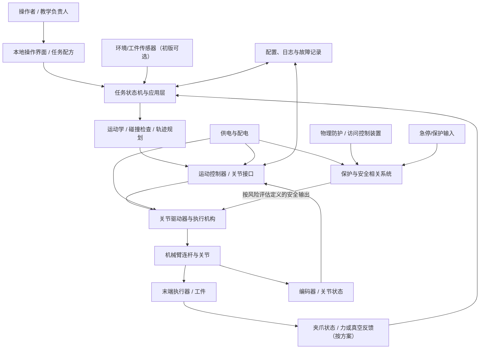

# 01｜系统需求与架构基线

## 0. 文档控制

| 字段 | 记录 |
|---|---|
| 项目 | REF-MANIP-001 |
| 文档编号/版本 | REF-MANIP-SYS-001 / 0.1-draft |
| 对应产品简报 | [00 项目章程](00-项目章程与产品简报.md) |
| 状态 | 概念架构，不是详细设计或设计冻结 |

## 1. 系统边界

系统包含机械臂本体、关节驱动与反馈、末端执行器、控制器、操作界面、必要传感器、供电/配电、物理防护与安全相关系统、配置/日志和维护工具。

外部参与者：操作者、教学/实验负责人、维护人员、供料托盘/治具、工件、实验室供电与场地设施。

初版不包含移动底盘、自动仓储系统、云端必需依赖、开放类别视觉识别或人员协作作业。若需增加，必须启动变更影响分析。

## 2. 功能分解（初步）

| 功能 ID | 功能 | 输入 | 输出 | 关键约束 |
|---|---|---|---|---|
| FN-001 | 接收任务配方 | 操作者选择、已批准配方 | 任务请求 | 权限、输入合法性、停止/取消语义 |
| FN-002 | 管理机器人状态 | 关节反馈、控制器/保护状态 | Ready/Busy/Fault 等状态 | 状态定义不可歧义 |
| FN-003 | 生成运动目标 | 目标位姿、任务约束 | 关节/末端目标 | 可达性、关节限制和坐标正确 |
| FN-004 | 规划与检查路径 | 当前状态、目标、碰撞场景 | 可执行候选轨迹 | 自碰撞、环境碰撞、速度/加速度约束 |
| FN-005 | 执行关节运动 | 经批准的轨迹 | 驱动器命令及反馈 | 控制周期、跟踪误差、异常停止 |
| FN-006 | 操作末端执行器 | 抓取/释放命令 | 夹爪状态/传感反馈 | 夹持失败检测和释放确认 |
| FN-007 | 管理保护与停止 | 保护装置、安全输入 | 允许运行/停止状态 | 由风险分析确定安全架构与验证 |
| FN-008 | 诊断与日志 | 状态、报警、任务事件 | 结构化记录 | 时间戳、序列号、版本和数据脱敏 |
| FN-009 | 维护/标定 | 受控维护命令和标定工装 | 参数/标定结果 | 角色权限、校准记录、变更审计 |

## 3. 概念系统架构

图为功能关系示意，未定义具体电气拓扑、冗余架构、性能等级、控制器安全能力或接线。安全输出如何影响驱动能量，必须依据适用标准、风险评估、部件安全手册和专业设计确定；不得仅以软件节点替代安全功能。

## 4. 需求分解原则

完整需求见 [05 需求追踪矩阵](05-需求追踪矩阵.csv)。当前优先系统需求族：

| 需求族 | 代表 ID | 责任专业 | 验证重点 |
|---|---|---|---|
| 功能 | SYS-F-001… | 产品/软件/控制 | 任务流程、异常/取消、状态一致性 |
| 机械 | SYS-M-001… | 机械/工艺 | 工作空间、强度/刚度、安装、工具与工件 |
| 电气/能源 | SYS-E-001… | 电气/嵌入式 | 供电预算、保护、接地、EMC/ESD、热 |
| 控制/运动 | SYS-C-001… | 控制/软件 | FK/IK、限位、轨迹跟随、奇异点处理 |
| 抓取 | SYS-G-001… | 机械/控制 | 夹持、滑移、掉落、工件损伤 |
| 安全 | SYS-S-001… | 安全/电气/机械 | 风险降低措施、保护功能、故障响应 |
| 软件/数据 | SYS-SW-001… | 软件/系统 | 版本、日志、配置、权限、错误处理 |
| 制造/服务 | SYS-Q-001… | NPI/质量/售后 | 序列号、批次追溯、校准、维修与交付 |

## 5. 关键架构决策（ADR）

### ADR-001｜固定式工作站，而非移动机械臂

**决定（草案）：** 初版机械臂固定安装于工作台/基座，不与 AMR 集成。

**原因：** 缩小安全边界和系统复杂度，单独学习机械臂运动学、抓取、驱动、规划和验证；避免移动底盘定位误差与操作臂误差同时引入。

**代价：** 不能学习移动操作或跨工位任务；相关能力留作后续产品变体。

**待验证：** 工作台稳定性、安装方式、作用载荷与倾覆/振动影响。

### ADR-002｜固定工装和已知取放位姿作为 MVP 起点

**决定（草案）：** 初版采用定位托盘/治具与已标定位置，不把通用视觉识别作为启动条件。

**原因：** 将重点放在运动学、控制、碰撞、抓取和系统工程，便于建立可复现基线。

**代价：** 对工件摆放和治具精度有依赖；需记录工件/托盘装夹公差。

### ADR-003｜控制功能与安全功能分层

**决定（原则）：** 普通任务规划和运动控制不作为唯一安全保护手段。安全相关功能由经风险评估确定的适用硬件/控制架构实现，并按要求验证。

**原因：** 普通应用软件、通用通信链路和未评估的 MCU 控制逻辑不能自动获得安全功能属性。

### ADR-004｜计算平台与实时控制的选型后置

**决定（草案）：** 先定义轴数、控制周期、反馈、轨迹执行、诊断和接口需求，再比较集成关节驱动器、专用运动控制器、MCU/实时控制器和上位计算机方案。

**原因：** 避免先选热门计算板，再发现控制接口、时序或厂商支持不满足需求。

## 6. 物理/软件架构比较（待可行性评审）

| 方案 | 结构/驱动思路 | 优点 | 风险/未知 | 下一步证据 |
|---|---|---|---|---|
| A：教学套件/成品臂 | 采购现成机械臂与驱动，外接应用控制 | 上手快，供应商资料可能较完整 | 结构/固件封闭、可维修性、供应期与接口限制 | 数据手册、SDK、EOL、手册/安全资料、实测 |
| B：模块化关节 | 机械臂自定义结构，采用集成伺服/闭环关节 | 模块边界清晰、可改造 | 成本、热、背隙、负载、通信和安全接口 | 负载谱、关节性能数据、热/寿命与集成测试 |
| C：分立电机+减速器 | 自行设计传动、驱动、电气和结构 | 学习深度和可控性高 | 工程量大、机械加工/标定/调试和风险较高 | 机械计算、驱动设计、台架与专业评审 |

未完成需求、器件数据和风险分析前，不指定优选方案。

## 7. 质量属性与预算

以下预算都要建立数值化约束，但当前没有足够输入填数值：

- 工作空间与可达性预算；
- 负载、重心、惯量与关节扭矩/热预算；
- 位置/姿态误差与误差传播预算；
- 速度、加速度、jerk 和停止距离预算；
- 电源容量、峰值电流、能耗和热预算；
- 控制/感知/通信时延与抖动预算；
- 声学、振动、结构刚度和耐久预算；
- BOM、制造成本、维护成本和产品生命周期成本；
- 风险降低与防护距离/访问控制要求。

预算的每个数值都必须记录来源、假设、配置、单位、工况和责任人。

## 8. 设计基线必须包含

- 机器人运动学结构定义、坐标系、关节方向和限位；
- 关节/驱动器/编码器/减速器/末端执行器的准确型号与数据手册；
- CAD、工程图、材料、公差、紧固和装配要求；
- 电气原理图、PCB、线束/连接器、供电/保护/接地；
- 控制周期、状态机、轨迹接口、故障语义和通信协议；
- 软件/固件仓库、依赖锁定、构建产物和升级/回滚流程；
- 风险分析、适用标准矩阵、安全验证和用户/维护文件；
- EBOM、制造工艺路线、检验和可追溯字段。

## 9. 评审与退出条件

G3 退出前至少要证明：

1. 系统边界、预期用途和 ODD 已评审；
2. 所有系统需求有唯一 ID、来源、验证方法和责任角色；
3. 机械、电气、控制、软件、工具和安全接口已形成 ICD；
4. 关键技术路线已比较，未决问题和风险有责任人；
5. 关键预算有初步分析方案；
6. 验证策略覆盖仿真、台架、真实硬件、可靠性和制造过程；
7. 不存在未评审的安全关键接口或不合理设计假设。

## 10. 相关文件

- [项目章程与 PRD](00-项目章程与产品简报.md)
- [接口控制与数据契约](02-接口控制与数据契约.md)
- [验证计划](03-DVPR验证计划与阶段门.md)
- [NPI 与交付](04-NPI量产与客户交付路线.md)
- [第 02 章系统工程任务计划](../../../docs/TaskPlan/02-需求定义与系统工程/TaskPlan.md)
- [第 14 章规划控制与机器人操作](../../../docs/TaskPlan/14-规划控制与机器人操作/TaskPlan.md)
